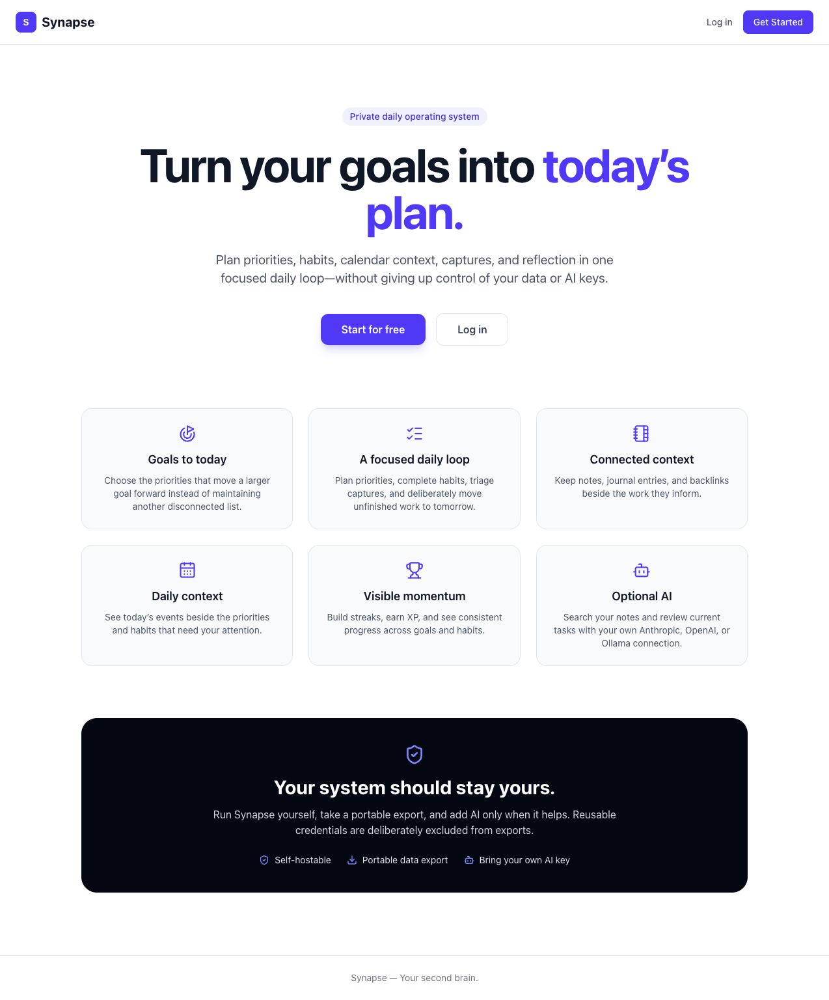

# Synapse

A private, self-hostable daily planner that connects your goals to today's tasks, habits, calendar, notes and reflection, with optional bring-your-own AI.



## What it is

Most people keep goals, to-dos, habits, notes and journal entries in five different apps. Synapse puts them in one daily loop: **Goals, Today, Execute, Reflect**. You set goals, plan a realistic day against them, capture things as they come up, and close the day with a short reflection. Your data stays exportable, accounts can be fully deleted, and AI is optional: you bring your own provider key (Anthropic, OpenAI) or point it at a local Ollama model.

Synapse is in private beta preparation and is not publicly launched.

## Features

- **Today**: focused daily plan pulling in priorities, habits, calendar events and goal-linked tasks
- **Goals**: hierarchical goals with tasks linked back to them
- **Todos**: priorities, due dates and quick add
- **Habits**: daily and weekly habits with streak tracking
- **Notes**: notes with `[[wikilink]]` backlinks and tags
- **Calendar**: events and day schedule context
- **Journal**: daily entries with gratitude and highlights
- **Inbox**: quick capture first, triage into tasks or notes later
- **AI chat**: multi-provider chat (Anthropic, OpenAI, Ollama) that can propose actions such as creating tasks; every change waits for explicit confirm, reject or undo
- **Global search** across notes, tasks, goals and more
- **Gamification**: XP, levels and achievements
- **Plugins**: permissioned, installable modules (sample manifests in `plugins/`)
- **Data control**: full JSON export and password-confirmed account deletion
- **PWA**: installable, with a service worker and in-app notifications

### Security and reliability details

- Email verification and password reset with hashed, single-use, time-limited tokens
- User AI provider keys encrypted at rest with AES-256-GCM
- Rate limiting on auth and plugin routes, per-user ownership checks on every resource
- Per-user upload quotas and an upload reconciliation script
- Health and readiness endpoints, backup and restore-drill scripts
- Production Compose files that refuse to start when required secrets are missing

## Tech stack

- **Framework**: Next.js 16 (App Router), React 19, TypeScript
- **Database**: PostgreSQL with Prisma 7 (`@prisma/adapter-pg`)
- **Auth**: NextAuth.js v4 (credentials) with bcrypt
- **Styling**: Tailwind CSS v4, Lucide icons
- **Validation**: Zod
- **AI**: Anthropic SDK, OpenAI SDK, Ollama
- **Email**: Resend adapter for transactional email
- **Tooling**: ESLint 9, `tsx --test` for tests, Docker multi-stage build, GitHub Actions CI

## Getting started

Requirements: Node.js 22 or newer, Docker (for local PostgreSQL).

```bash
# 1. Install dependencies
npm ci

# 2. Start PostgreSQL
docker compose up -d

# 3. Create your env file, then fill in the database URL,
#    auth secret and 32-byte encryption key
cp .env.example .env
# PowerShell: Copy-Item .env.example .env

# 4. Generate the Prisma client, run migrations and seed
npm run setup

# 5. Start the dev server
npm run dev
```

Open [http://localhost:3000](http://localhost:3000).

### Database commands

```bash
npm run db:generate    # Generate Prisma client
npm run db:migrate     # Run migrations
npm run db:seed        # Seed achievements and plugins
npm run db:studio      # Open Prisma Studio
npm run db:reset       # Reset the database
```

## Testing and checks

```bash
npm test               # Contract and regression tests (tests/*.test.ts)
npm run typecheck      # TypeScript, no emit
npm run lint           # ESLint, zero warnings allowed
npm run build          # Production Next.js build
```

CI runs all four against a disposable PostgreSQL service after applying migrations.

## Project structure

```text
synapse/
├── prisma/            # Schema, migrations, seed
├── plugins/           # Plugin manifests
├── public/            # PWA manifest, service worker, icons
├── src/
│   ├── app/           # App Router pages and API routes
│   ├── components/    # React components
│   └── lib/           # Auth, AI providers and tools, plugins, validation, helpers
├── scripts/           # Backup/restore, lifecycle smoke test, metrics, release checks
├── tests/             # Contract and regression tests
├── ai-evals/          # Evaluation cases for AI action proposals
└── docker-compose.yml # Local PostgreSQL
```

## License

MIT. See [LICENSE](LICENSE).
